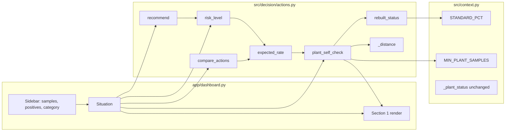

# Design Document: Plant Self-Check

## Overview

Plant Self-Check adds two optional counts to the "Your lot" sidebar: routine FSIS Salmonella samples in the plant's last 52 weeks, and positives among them. The Decision_Engine (`src/decision/actions.py`) rebuilds the plant's FSIS category from those counts using the same rule as `src/context.py::_plant_status`. It reports the observed percent positive and how many positives separate the line from the neighboring category. When no published category is entered, it uses the rebuilt category to pick the forward rate for `expected_rate`.

Design decisions:

- All logic lives in `src/decision/actions.py`. The Dashboard builds a `Situation`, calls the engine and renders the fields it gets back. It does no arithmetic and no comparisons.
- `STANDARD_PCT` and `MIN_PLANT_SAMPLES` are imported from `src.context`, not copied. `context._plant_status` is not touched.
- Category boundaries use exact rational arithmetic (`fractions.Fraction`) so that 9.8, 15.4, 7.1 and 13.5 never cause a float boundary error.
- A published category always wins for `expected_rate`. The rebuilt category is used only when the published category is "Not listed".
- Because `risk_level` and `compare_actions` already get their rate from `expected_rate`, changing `expected_rate` updates both. Neither needs a separate change.
- No new dependencies. Hypothesis is not installed, and the input space is small and bounded, so the correctness properties are checked with exhaustive pytest sweeps. That is stronger than random sampling here.
- No plant name or establishment ID is requested, stored or shown. No message makes an outbreak or illness claim.
- Reachable groups: `PRODUCTS` maps the five Sidebar products to three groups only (Ground chicken 25.0%, Ground turkey 13.5%, Chicken parts 15.4%). `plant_self_check` therefore only sees those three standards. `rebuilt_status` and `_distance` take the standard directly, so they are tested over all five `STANDARD_PCT` groups, including the carcass standards (9.8%, 7.1%). For the three reachable groups at n ≥ 10, a Category 1 line always moves to Category 2 and a Category 3 line always drops to Category 2, which matches the request. The "category reached" field only differs from the neighboring category for the carcass standards.

Regulatory framing: the FSIS categories follow the Salmonella performance standards FSIS verifies for poultry under 9 CFR 381 (standards from 81 FR 7285, 2016), and the plant's own controls run under its HACCP plan, 9 CFR 417. The self-check is decision support. It is not an FSIS determination and it authorizes nothing.

## Architecture



Data flow for one Dashboard run:

1. The Sidebar collects `plant_samples` and `plant_positives` (integers, minimum 0, default 0) with the existing inputs.
2. The Dashboard builds `Situation(..., plant_samples=..., plant_positives=...)`.
3. The Dashboard calls `A.plant_self_check(s)`, `A.risk_level(s, inp)`, `A.recommend(s, inp)` and `A.compare_actions(s, inp, ...)`.
4. `expected_rate` calls `plant_self_check(s)` internally when the published category is "Not listed".
5. Section 1 renders the `SelfCheck` fields and messages. It renders nothing extra when the result is `None`.

Import note: `src/context.py` imports `forecast`, `outlook`, `weather` and others at module level. None of those import `src.decision`, so `from ..context import STANDARD_PCT, MIN_PLANT_SAMPLES` creates no import cycle. `src/scenarios.py` imports `actions`, and `actions` will now import `context`. That is still acyclic. The test module already imports `context`, so there is no new import cost in tests.

## Components and Interfaces

### Situation (extended)

Two fields are added with defaults. Every existing caller, including `src/scenarios.py` and the tests, keeps working unchanged:

```python
@dataclass
class Situation:
    ...
    plant_samples: int = 0      # routine FSIS samples, plant's last 52 weeks; 0 = not entered
    plant_positives: int = 0    # Salmonella positives among plant_samples
```

### SelfCheck (new result type)

```python
@dataclass(frozen=True)
class SelfCheck:
    """A plant's FSIS category rebuilt from its own last 52 weeks of routine samples.
    Decision support only, not an FSIS determination."""
    samples: int
    positives: int
    product_group: str
    standard_pct: float                 # STANDARD_PCT[product_group]
    observed_pct: float | None          # 100*k/n, None when no status is rebuilt
    status: int | None                  # 1, 2, 3 or None (too small or invalid)
    positives_to_next: int | None       # Category 1 or 2 only
    next_status: int | None             # category reached after positives_to_next more
    positives_to_drop: int | None       # Category 3 only
    drop_status: int | None             # category reached after positives_to_drop fewer
    message: str                        # one plain sentence for Section 1
    published_note: str | None = None   # set only when a published category differs from status
```

### Public functions

```python
from fractions import Fraction
from ..context import MIN_PLANT_SAMPLES, STANDARD_PCT

SELF_CHECK_NOTE: str  # "Self-check for decision support, rebuilt from the counts you entered. Not an FSIS determination."

def rebuilt_status(positives: int, samples: int, standard_pct: float) -> int:
    """FSIS category from counts, exact at the boundaries.
    1 if 100k/n <= std/2, 2 if <= std, else 3. Requires samples > 0 and 0 <= positives <= samples."""

def plant_self_check(s: Situation) -> SelfCheck | None:
    """None when no samples were entered. Otherwise a SelfCheck with a status, or
    with status None and a message saying why (too few samples, or invalid counts)."""
```

Private helpers:

```python
def _std(standard_pct: float) -> Fraction:
    """Exact rational of the published standard: Fraction(str(9.8)) == Fraction(49, 5)."""

def _distance(positives: int, samples: int, std: Fraction, status: int) -> tuple[int | None, int | None]:
    """(count, category reached). Category 1/2: fewest added positives that raise the
    category. Category 3: fewest removed positives that bring the line to the standard or below."""
```

Every new public name (`SelfCheck`, `rebuilt_status`, `plant_self_check`, `SELF_CHECK_NOTE`, `STANDARD_PCT`, `MIN_PLANT_SAMPLES`) is added to `__all__`. All functions are type-hinted.

### Exact boundary arithmetic

The standard is turned into an exact rational with `Fraction(str(std))`. `str()` gives the shortest repr, so `"9.8"` becomes `49/5`, not the binary expansion of 9.8. With `std = p/q`, `k` positives and `n` samples:

| Test | Exact form | Integer form |
|---|---|---|
| Category 1: 100k/n ≤ std/2 | `200*k <= std*n` | `200*k*q <= p*n` |
| Category 2: 100k/n ≤ std | `100*k <= std*n` | `100*k*q <= p*n` |
| Category 3 | otherwise | otherwise |

```python
def rebuilt_status(positives: int, samples: int, standard_pct: float) -> int:
    std = _std(standard_pct)
    if 200 * positives <= std * samples:
        return 1
    if 100 * positives <= std * samples:
        return 2
    return 3
```

Distances, using `floor` on a Fraction (`math.floor` or `//` gives an exact integer):

- Category 1 to higher: the smallest `k' > k` with `200k' > std·n` is `k' = floor(std·n/200) + 1`, so `positives_to_next = floor(std·n/200) + 1 − k`. This is ≥ 1 because Category 1 means `k ≤ std·n/200`.
- Category 2 to Category 3: `k' = floor(std·n/100) + 1`, `positives_to_next = k' − k ≥ 1`.
- Category 3 to the standard or below: the largest `k' < k` with `100k' ≤ std·n` is `k' = floor(std·n/100)`, so `positives_to_drop = k − floor(std·n/100) ≥ 1`.
- The category reached is `rebuilt_status(k', n, std)`. It is reported because it is not always the next category. For example, Turkey carcass (7.1%) at n = 10: one positive is 10%, so Category 3. Dropping 1 positive gives 0%, which is Category 1. From 0 positives, 1 more jumps straight to Category 3. The message names the category actually reached, so it never overstates a one-step move.
- If `k' > n` (more positives than samples), the move is impossible at the same sample count, and `positives_to_next` is `None` with a message saying so. Every current standard is below 50% for half and below 100% for the full standard, and n ≥ 10, so this does not happen today. The guard keeps the function total.

Worked boundaries (all exact). Chicken carcass is not a Sidebar product group, so its rows are tested through `rebuilt_status(k, n, STANDARD_PCT["Chicken carcass"])`, not `plant_self_check`:

| Group | Std | n | k | Observed | Status |
|---|---|---|---|---|---|
| Chicken parts | 15.4 | 500 | 38 | 7.6% | 1 |
| Chicken parts | 15.4 | 1000 | 77 | 7.7% = std/2 | 1 |
| Chicken parts | 15.4 | 1000 | 78 | 7.8% | 2 |
| Chicken parts | 15.4 | 500 | 77 | 15.4% = std | 2 |
| Chicken parts | 15.4 | 500 | 78 | 15.6% | 3 |
| Ground chicken | 25.0 | 40 | 5 | 12.5% = std/2 | 1 |
| Ground chicken | 25.0 | 40 | 10 | 25.0% = std | 2 |
| Chicken carcass | 9.8 | 500 | 49 | 9.8% = std | 2 |
| Chicken carcass | 9.8 | 1000 | 49 | 4.9% = std/2 | 1 |

### plant_self_check: order of checks

```python
def plant_self_check(s: Situation) -> SelfCheck | None:
    group = PRODUCTS[s.product][0]
    std_pct = STANDARD_PCT[group]
    n, k = s.plant_samples, s.plant_positives
    if n == 0:                                   # Req 4.3, 6.7: not entered
        return None
    if n < 0 or k < 0 or k > n:                  # Req 4.4: invalid
        return SelfCheck(..., status=None,
                         message="Positives cannot exceed samples. Check the counts; "
                                 "the self-check is not used.")
    if n < MIN_PLANT_SAMPLES:                    # Req 4.1
        used = ("The national rate is used." if s.fsis_category is None else
                f"The published FSIS Category {s.fsis_category} drives the expected rate.")
        return SelfCheck(..., status=None,
                         message=f"{n} samples is too small to rebuild a category "
                                 f"(at least {MIN_PLANT_SAMPLES} needed). {used}")
    status = rebuilt_status(k, n, std_pct)
    ...distance, message, published_note...
```

Precedence notes:
- n = 0 is "not entered" even if positives > 0. The Sidebar default is 0/0, and Requirements 4.3 and 6.7 define 0 samples as no self-check. The invalid check applies only when n > 0.
- When 0 < n < Minimum_Samples and k > n, the invalid message wins (Requirement 4.1 applies only when k ≤ n). Both cases return no status, and both give the same `expected_rate`: national when "Not listed", published otherwise. So Requirements 4.2 and 4.5 agree.
- The too-small message says the national rate is used only when no published category is entered. With a published category it says that category drives the expected rate, so the message never contradicts "published always wins".
- Negative counts can't come from the Sidebar (minimum 0). They are treated as invalid so the engine never raises on direct calls.

Messages (built in the engine, shown as-is by the Dashboard):

- Category 1 or 2: `"{k} of {n} samples positive ({pct:.1f}%) against the {std:g}% standard: Category {status}. {d} more positive(s) at the same {n} samples would move the line to Category {next}."`
- Category 3: `"... Category 3. {d} fewer positive(s) at the same {n} samples would bring the line to Category {drop} (at or below the standard)."`
- `published_note` (only when the published category is 1, 2 or 3 and differs from the status): `"Your last 52 weeks of samples read Category {status}; the published FSIS Category {published} drives the expected rate."`

`observed_pct` is `float(Fraction(100*k, n))` for display. The status never depends on that float.

### expected_rate (changed)

```python
def expected_rate(s: Situation, inp: dict) -> tuple[float, str]:
    """Share of samples expected positive, and where the number came from.
    A published FSIS category always wins. With none, a category rebuilt from the
    plant's own last 52 weeks of samples is used. Otherwise the national rate."""
    group = PRODUCTS[s.product][0]
    if s.fsis_category is not None:
        rate = inp["forward"].get((group, s.fsis_category))
        if rate is not None:
            return rate, f"Category {s.fsis_category} {group.lower()} lines, the following year"
        return inp["rates"][group], f"national {group.lower()} rate"
    check = plant_self_check(s)
    if check is not None and check.status is not None:
        rate = inp["forward"].get((group, check.status))
        if rate is not None:
            return rate, (f"Category {check.status} {group.lower()} lines, the following year, "
                          "using the status rebuilt from your plant's last 52 weeks of samples")
    return inp["rates"][group], f"national {group.lower()} rate"
```

With a published category, this returns exactly what the current code returns. With "Not listed" and no usable self-check (n = 0, too small, invalid), it returns the national rate as it does today. So existing tests and `artifacts/scenarios` outputs do not change. The scenarios don't set the new fields, so they default to 0.

`risk_level` and `compare_actions` are not edited. Both call `expected_rate` and pick up the new rate automatically (Requirement 5.4).

### Dashboard changes (`app/dashboard.py`)

Sidebar, placed directly after the FSIS category selectbox. Selectbox order stays the same, so `tests/test_app.py` indices still hold:

```python
st.caption("Optional self-check from your own FSIS results. Counts only.")
n_samples = st.number_input("Routine FSIS samples, your plant's last 52 weeks", min_value=0,
                            value=0, step=1, key="plant_samples")
n_pos = st.number_input("Positives among those samples", min_value=0, value=0, step=1,
                        key="plant_positives")
```

`Situation(...)` gets `plant_samples=int(n_samples), plant_positives=int(n_pos)`.

The two new inputs shift the sidebar `number_input` indices (hours and HACCP limit move from 1–2 to 3–4). No current test uses `number_input` indices, and the new AppTest case addresses the inputs by `key`, not by index. The Sidebar default for the FSIS category stays Category 1 (`index=1`), so a user must pick "Not listed" for the self-check to drive the rate. The published note makes that visible when the two disagree.

The existing Section 1 caption ("An unlisted line uses the national rate.") becomes incomplete. It changes to: "An unlisted line uses the national rate, or the category rebuilt from your own samples when you enter at least 10." (Requirement 6.10). This is display text only, not a README number.

Section 1, after the existing reasons list. It is render-only, and it uses `st.info`/`st.warning`/`st.caption`, not `st.success`, so `app.success[0]` stays the recommendation:

```python
check = A.plant_self_check(s)
if check is not None:
    st.subheader("Your plant's self-check")
    if check.status is None:
        st.warning(check.message)
    else:
        d1, d2, d3, d4 = st.columns(4)
        d1.metric("Observed positive", f"{check.observed_pct:.1f}%")
        d2.metric("Samples / positives", f"{check.samples} / {check.positives}")
        d3.metric("Rebuilt category", f"Category {check.status}")
        d4.metric("FSIS standard", f"{check.standard_pct:g}%")
        st.info(check.message)
        if check.published_note:
            st.warning(check.published_note)
    st.caption(A.SELF_CHECK_NOTE)
```

The Dashboard compares nothing and computes nothing. The note about the published category comes from the engine.

## Data Models

| Field | Type | Source | Constraint |
|---|---|---|---|
| `Situation.plant_samples` | `int` | Sidebar | ≥ 0, default 0 |
| `Situation.plant_positives` | `int` | Sidebar | ≥ 0, default 0 |
| `STANDARD_PCT` | `dict[str, float]` | `src.context` | imported, keyed by Product_Group |
| `MIN_PLANT_SAMPLES` | `int` | `src.context` | imported, currently 10 |
| `inp["forward"]` | `dict[(str, int), float]` | `category_forward_rates.csv` | unchanged |
| `inp["rates"]` | `dict[str, float]` | `product_rates.csv` | unchanged |
| `SelfCheck` | frozen dataclass | `plant_self_check` | see above |

Nothing is persisted. No file under `artifacts/` is read differently or written. No README number changes.

## Error Handling

| Condition | Result | Expected_Rate |
|---|---|---|
| n = 0 | `plant_self_check` returns `None`, no block shown | unchanged from today |
| n > 0 and (k > n or a count < 0) | `SelfCheck(status=None)`, "Positives cannot exceed samples" | unchanged from today |
| 0 < n < 10, 0 ≤ k ≤ n | `SelfCheck(status=None)`, "too small ..." plus "national rate is used" (Not listed) or "published Category c drives the expected rate" | national if Not listed, published otherwise |
| n ≥ 10, Not listed | status 1–3 | `forward[(group, status)]`, basis says rebuilt from last 52 weeks |
| n ≥ 10, published c | status 1–3, `published_note` if c ≠ status | `forward[(group, c)]` |
| distance target k′ > n | `positives_to_next = None`, message says a change is not reachable at this sample count | unaffected |
| `(group, status)` missing from forward table | falls back to national rate | national |

The engine never raises on Sidebar-reachable input. `rebuilt_status` is a precondition-checked helper. It raises `ValueError` if called directly with `samples <= 0` or `positives` outside `[0, samples]`, so misuse is loud and doesn't produce a quiet wrong category.

## Correctness Properties

*A property is a characteristic or behavior that should hold true across all valid executions of a system, essentially a formal statement about what the system should do. Properties serve as the bridge between human-readable specifications and machine-verifiable correctness guarantees.*

Reflection on redundancy: criteria 2.2, 2.3, 2.4 and 2.5 are one rule, so they are merged into the first property below. Agreement with `_plant_status` is kept separately because it checks consistency with the published analysis, not just the definition. Criteria 3.1–3.4 are merged into one minimality check. 4.1/4.2 and 4.4/4.5 each pair a message with a rate, so each pair is merged. 5.5 is implied by the small-sample and invalid-count checks. 5.1 and 5.2 are merged. The 6.2/6.3 message content goes into the distance check. 6.9 gets its own entry because it covers every message.

### Property 1: Rebuilt status follows the exact FSIS rule

For all five `STANDARD_PCT` groups g, all sample counts n with MIN_PLANT_SAMPLES ≤ n ≤ 400 and all positives 0 ≤ k ≤ n, `rebuilt_status(k, n, STANDARD_PCT[g])` equals the exact rational reference: 1 if 200k ≤ Fraction(str(std))·n, else 2 if 100k ≤ Fraction(str(std))·n, else 3. For all five Sidebar products over the same (n, k) grid, `plant_self_check` returns `observed_pct == 100k/n`, `standard_pct == STANDARD_PCT[PRODUCTS[product][0]]` and that same status. In particular, an observed percent exactly equal to std/2 gives Category 1 and exactly equal to std gives Category 2.

**Validates: Requirements 2.1, 2.2, 2.3, 2.4, 2.5, 2.7**

### Property 2: Self-check agrees with the published analysis rule

For all product groups g, all n with MIN_PLANT_SAMPLES ≤ n ≤ 200 and all 0 ≤ k ≤ n, `rebuilt_status(k, n, STANDARD_PCT[g])` equals the status `context._plant_status` assigns to a single synthetic line with n routine samples of which k are positive.

**Validates: Requirements 2.2, 2.3, 2.4, 2.6, 7.7**

### Property 3: Distance to the neighboring category is minimal and positive

Write `R(k) = rebuilt_status(k, n, std)`. For all five `STANDARD_PCT` groups (via `_distance`) and all five Sidebar products (via `plant_self_check`), all n with MIN_PLANT_SAMPLES ≤ n ≤ 400 and all 0 ≤ k ≤ n with rebuilt status r:
- if r ∈ {1, 2}, `positives_to_next = d` is an integer ≥ 1, `R(k+d) > r`, `R(k+d−1) == r`, and `next_status == R(k+d)`;
- if r = 3, `positives_to_drop = d` is an integer ≥ 1, `R(k−d) ≤ 2`, `R(k−d+1) == 3`, and `drop_status == R(k−d)`;
- for the Sidebar products, the message also contains d, "same {n} samples" and the category reached, and the category reached is always the neighboring one (Category 2 from 1, Category 3 from 2, Category 2 from 3).

**Validates: Requirements 3.1, 3.2, 3.3, 3.4, 6.2, 6.3**

### Property 4: Too few samples are flagged and fall back to the national rate

For all products, all published options c ∈ {None, 1, 2, 3}, all n with 1 ≤ n < MIN_PLANT_SAMPLES and all 0 ≤ k ≤ n, `plant_self_check` returns a result with `status is None` and a message stating the sample count is too small. With c = None the message says the national rate is used and `expected_rate` returns `inp["rates"][group]`. With c ∈ {1, 2, 3} the message says the published Category c drives the expected rate and `expected_rate` returns `forward[(group, c)]`.

**Validates: Requirements 4.1, 4.2, 5.3, 5.5**

### Property 5: Invalid counts are rejected and leave the rate unchanged

For all products, all published options c ∈ {None, 1, 2, 3}, all n ≥ 1 and all k > n, `plant_self_check` returns `status is None` with a message stating positives cannot exceed samples, and `expected_rate` equals `expected_rate` for the same situation with `plant_samples=0, plant_positives=0`.

**Validates: Requirements 4.4, 4.5, 5.5**

### Property 6: A published category always wins

For all products, all published categories c ∈ {1, 2, 3} and all sampling records (n, k) with 0 ≤ n ≤ 200 and 0 ≤ k ≤ n + 2, `expected_rate` equals `expected_rate` for the same situation with `plant_samples=0`, which is `forward[(group, c)]`. This includes records whose rebuilt status differs from c.

**Validates: Requirements 5.3, 4.3, 7.4**

### Property 7: Not listed uses the rebuilt status for the rate

For all products, all n with MIN_PLANT_SAMPLES ≤ n ≤ 200 and all 0 ≤ k ≤ n, with `fsis_category=None`, `expected_rate` returns `forward[(group, status)]` where `status` is the rebuilt status, and the basis string states that the rate uses the status rebuilt from the plant's last 52 weeks of samples.

**Validates: Requirements 5.1, 5.2**

### Property 8: risk_level and compare_actions use the chosen rate

For all products, all published options c ∈ {None, 1, 2, 3} and a grid of sampling records spanning all three rebuilt categories, small n, invalid counts and n = 0, `risk_level(s)[1] == round(100 * expected_rate(s)[0], 1)` and the "Release raw under normal HACCP" exposure index in `compare_actions(s)` equals `round(expected_rate(s)[0] / inp["rates"]["Chicken parts"], 2)`.

**Validates: Requirements 5.4**

### Property 9: Disagreement note appears exactly when published and rebuilt differ

For all products, all published options c ∈ {None, 1, 2, 3} and all n with MIN_PLANT_SAMPLES ≤ n ≤ 200, 0 ≤ k ≤ n with rebuilt status r: `published_note` is non-empty if and only if c is not None and c ≠ r. When present, it names Category r, names Category c, refers to the last 52 weeks, and says the published category drives the expected rate.

**Validates: Requirements 6.4**

### Property 10: Messages make no plant, outbreak or illness claim

For all products, all published options and all sampling records in the grids above (valid, small, invalid), the text of `message`, `published_note` and `SELF_CHECK_NOTE` contains neither "outbreak" nor "illness", and `SELF_CHECK_NOTE` states the result is not an FSIS determination.

**Validates: Requirements 6.8, 6.9**

Requirement 6.10 (the Section 1 caption wording) is display text. It is covered by the AppTest smoke check, not a property.

## Testing Strategy

All tests go in `tests/test_decision.py` and run with `.\.venv\Scripts\python.exe -m pytest -q tests`. The existing tests, including `test_status_follows_fsis_definition` and every `tests/test_app.py` check, must keep passing unchanged.

Property tests. Hypothesis is not in `requirements.txt` or the venv, and adding a dependency is out of scope. The input space is bounded and cheap (pure integer and Fraction arithmetic), so each property is checked by an exhaustive sweep over the stated grid. That covers far more than 100 cases per property and includes every exact boundary. Each property test is tagged in its docstring:

```python
def test_status_follows_exact_rule():
    """Feature: plant-self-check, Property 1: Rebuilt status follows the exact FSIS rule."""
```

- Properties 1 and 3 sweep 5 groups × n ∈ [10, 400] × k ∈ [0, n] (about 400k cases, pure arithmetic, a few seconds).
- Property 2 builds one synthetic DataFrame per group holding many synthetic establishment IDs, one per (n, k) pair, and calls `_plant_status` once per group. This keeps it fast. The IDs are synthetic integers, not plant names.
- Properties 4–9 sweep products × published options × a smaller (n, k) grid, using the module-scoped `inp` fixture.

Example and edge-case tests (Requirement 7):

- `MIN_PLANT_SAMPLES − 1` samples gives no status and the too-small message. `MIN_PLANT_SAMPLES` samples gives a status (7.1).
- Exact boundaries from the worked table: Chicken parts 77/1000 → 1, 78/1000 → 2, 77/500 → 2, 78/500 → 3. Ground chicken 5/40 → 1, 10/40 → 2. Chicken carcass 49/500 → 2, 49/1000 → 1 (7.2).
- Positives_To_Next for Category 1 (Chicken parts 38/500 → 1 more, to Category 2), for Category 2 (Chicken parts 77/500 → 1 more, to Category 3) and Positives_To_Drop for Category 3 (Chicken parts 100/500 → 23 fewer, to Category 2), all through `plant_self_check` with "Chicken breast". Plus the Turkey carcass n = 10 jump case through `_distance` directly (0/10 → 1 more reaches Category 3; 1/10 → 1 fewer reaches Category 1), because no Sidebar product uses the carcass standards (7.3).
- Do not assert that the expected rate rises with the rebuilt category for Ground turkey. In `category_forward_rates.csv` its Category 2 forward rate (8.9%) is below Category 1 (9.2%). The existing monotonic test covers Ground chicken and Chicken breast only.
- Published Category 1 with a record that rebuilds to Category 3 gives the Category 1 forward rate and a `published_note` (7.4).
- 12 positives of 10 samples gives no status and the published or national rate (7.5).
- `A.STANDARD_PCT is context.STANDARD_PCT` and `A.MIN_PLANT_SAMPLES == context.MIN_PLANT_SAMPLES`. The new names are in `A.__all__` (2.6, 2.8).
- 0 samples gives `None` (4.3).

Smoke and UI checks: the existing `tests/test_app.py::test_page_runs` covers the Dashboard loading with the new inputs at their defaults. An optional AppTest case sets the samples and positives inputs by key (`app.sidebar.number_input(key="plant_samples")`, `key="plant_positives"`) and asserts no exception and that the self-check caption is shown. That check runs only after `python run_all.py`, the same as the existing app tests.

Unchanged-results checks (7.7): `git diff --stat` shows no change to `src/context.py`, `README.md` or `artifacts/`. `test_status_follows_fsis_definition` still passes.
