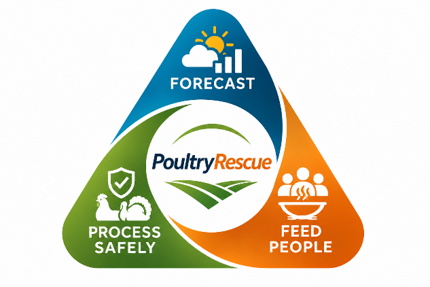

<p align="center"></p>

# PoultryRescue

Lot-level Salmonella decision support for the QA or HACCP lead at a small or very small ground poultry plant.
NAFSI Hub Student Data Challenge, Fall 2026, Sens-D track.

**[Open the app](https://waqarsaleem320.github.io/early-signal/).** Its code is in [`web/`](web). Its results come from [`artifacts/`](artifacts), built by `python run_all.py` from [`data/`](data).

## The problem

A plant whose ground poultry line is sliding toward the FSIS Category 3 standard has to decide what
to do before results get worse, without wasting protein. In the September 2026 FSIS posting, 21 of 37
categorized ground chicken lines were in Category 3, compared with 48 of 436 chicken parts lines. Of
those 37 lines, 29 are at small or very small plants (only one is very small), as are 76 of the 98 Category 3 lines across all
products (MPI directory sizes). Another 122 ground chicken lines have no published category, so the
tool falls back to the national rate for them.

## What is new

To our knowledge, this is the first public-data test of how well a plant's published FSIS Salmonella
category predicts its next-year positivity, and the first tool that scores lot actions on both exposure and
food delivered to high-need counties. Plant-level persistence research and test-driven lot software
already exist, and one study found Category 3 linked to higher positivity in retail samples at the same
time (Mujahid et al. 2023). Our literature and web search was not exhaustive.

## What the tool does

1. Turns a plant's own FSIS category and product into expected Salmonella positivity next year, measured
   forward in time on public FSIS samples.
2. Compares that with the FSIS standard and recommends an action for the lot. A plant can also enter its
   own sample counts to see its rebuilt category and how many positives separate it from the next one.
   This is the route for lines with no published category. It is not an FSIS determination.
3. Compares every action on exposure, servings kept, protein kept and servings for high-need counties.
4. Lists high-need counties in the plant's state for donated cooked product.
5. Shows a state risk map and alerts for human Salmonella cases as context. They do not change the risk level.

The Live now tab reads National Weather Service alerts and the FSIS recall list in the browser. These feeds are
context only: they never change the risk level or the recommendation, and the app shows recall counts without company names.

## What it does not do

- It does not predict outbreaks or count illnesses avoided.
- It does not judge any company and names no plants.
- It is not a regulatory determination, and it authorizes nothing. A qualified person reviews every
  high-consequence decision.
- FSIS says its sampling data should not be used to identify outbreaks, link samples to outbreaks, or
  show that samples are causally related.

## Main results

Results below are from `python run_all.py`. Validation is retrospective, using the latest data vintage.

| Check | Result |
|---|---|
| Ground chicken positivity after a published category | Category 1: 13.4%. Category 2: 23.3%. Category 3: 47.3% (95% CI 39.2 to 56.7) |
| Same result in each of four years | Ground chicken Category 1 ran 11.8% to 15.1%, Category 3 ran 41.6% to 55.0% |
| Chicken parts positivity after a published category | Category 1: 6.3%. Category 2: 10.0%. Category 3: 17.5% |
| Ground turkey positivity after a published category | Category 1: 8.0%. Category 2: 16.5%. Category 3: 25.1% |
| Published category and product vs product alone, held-out posting from July 2025 | Brier score 4.3% lower on 22,084 samples (95% CI 2.9 to 6.0) |
| Same test on rebuilt categories, three year-pairs | Ground chicken 13.6%, 21.3%, 45.9%. Brier score 4.9% lower on 20,976 samples (95% CI 3.4 to 6.5) |
| Rebuilt status vs published FSIS category | Same in 79% to 96% of lines, by product |
| Three-month forecast vs best fair baseline | MAE 5.1% lower (poultry serotypes), 6.1% (Enteritidis), 12.1% (all Salmonella) |
| Adding FSIS, weather and storm data | No improvement over history, season and trend |
| Alert, threshold set on 2022-2023, tested on 2024 onward | Poultry serotypes: 53.8% precision vs 25.9% base rate, 20.5% recall, 73 false alarms in 158 alerts. Precision by year: 2024 64.4%, 2025 49.1%, 2026 16.7% (18 alerts). It held in 2024-2025 and failed in 2026, cause unknown, so the alert does not drive the risk level |
| Ground chicken positivity since June 2023 | About 33%, vs about 8% for chicken parts |
| Season in chicken carcass positivity since June 2023 | About 5% in both halves of the year. The older summer rise is not present now |
| A high plant quarter repeats next quarter | 40.3% vs 9.1% for other plant quarters |

The fair baselines are a same-month value, a three-year same-month mean, and a seasonal GLM.

Category results use FSIS routine samples. The published test takes four archived FSIS postings, with
sample windows ending July 2022, 2023, 2024 and 2025, and scores each line on the 52 weeks after its window.
The rebuilt test applies the FSIS rule (Category 1 at or below half the standard, Category 3 above it,
81 FR 7285) to one 52-week window, then scores the next 52 weeks, from September 2023, 2024 and 2025.
Lines need 10 or more samples in the scoring window. Intervals resample plants. Raw samples end in June
2026, so the last window in each test is short. Each posting's scoring window is about the
next posting's sample window, so the four years are chained, not independent. A published category uses published rates in the app;
the self-check uses rebuilt rates.

## Run it

Tested on Python 3.11.9 on Windows.

```bash
python -m venv .venv
.venv\Scripts\activate
pip install -r requirements.txt
python run_all.py
python -m pytest -q tests
python -m http.server 8600 --directory web
```

Open http://localhost:8600. To publish it, serve the `web/` folder with GitHub Pages. The analyst view runs
with `streamlit run app/dashboard.py`.

On macOS or Linux, use `source .venv/bin/activate`. `run_all.py` takes about 5 minutes. All inputs are in
`data/`. No API keys are needed. Results are also included in `artifacts/`, so the app runs without
`run_all.py`.

## Layout

| Path | Contents |
|---|---|
| `web/` | The app: a static web app with no server. `engine.js` is tested against the Python engine |
| `app/` | Streamlit analyst view: lot decision, hotspot map, forecast detail |
| `src/forecast.py`, `src/outlook.py` | Forecast, baselines, alert backtest |
| `src/context.py` | Product rates, category forward test, county need, live outlook |
| `src/decision/` | Risk rule, action comparison, safety review, cooking yields |
| `src/scenarios.py` | Four worked scenarios |
| `artifacts/` | Generated results |
| `tests/` | Rule, arithmetic and app-load checks |
| `DATA_DICTIONARY.md` | Source, access date, license, coverage, changes and limits for each dataset |

## Known limits

- Risk levels compare expected positivity with the FSIS standard. A sample result is not a lot result.
- Ground chicken Category 1 reads Elevated narrowly: 13.4% from 18 plants, 95% CI 10.4 to 17.1, against a 12.5% threshold. The level compares point estimates.
- Few ground lines qualify: 32 Category 1 and 29 Category 2 ground chicken line-postings, and category lists shrank in 2025. On rebuilt status, ground turkey Categories 1 and 2 do not separate.
- Plants with fewer than 10 samples are left out of the category rates, so small plants are under-represented. Category 3 lines dropped for too few samples ran higher than kept lines in one posting and lower in the other. Lines at plants missing from the current MPI directory are lost in the join. Very low volume samples are not in the routine programs used here.
- Next-year Category 3 rates vary by year (see `category_published_by_year.csv`), more than the pooled interval suggests.
- The need score mixes modeled food insecurity with SVI, and the two overlap. CDC food insecurity is missing for CO, FL, KY, OR, PA, SD, TN, TX, VT, WA and WY. Connecticut is not in the county list, because its county codes changed. Food organizations come from the IRS list, which misses many church pantries.
- Earlier FSIS postings are Internet Archive copies of FSIS files.
- Rebuilt status is an approximation: FSIS assesses all completed 52-week windows over three months, and uses count tables.
- FSIS reported samples missing from June-July 2025, which affected postings from that period, so the 2025 posting may predate the fix. With that posting left out, the held-out gain is 3.1% (95% CI 1.6 to 4.6), and ground chicken runs 12.9%, 24.3% and 43.9%.
- A plant's own last-year rate predicts slightly better than its category. The category is what the tool can compare across plants from public data.
- The 2-hour limit above 40°F is FSIS consumer guidance. The plant's HACCP critical limit governs (9 CFR 417.2), and the app lets the user set it.
- A surge means well above the last three years. Baselines include low COVID-era counts, so about a quarter of state-months count as surges. A surge is not an outbreak.
- Exposure index adjusts for product and FSIS category, not serotype or dose.
- "Poultry-associated serotypes" is a judgment label; Enteritidis and Typhimurium also come from other foods.
- Product rates use June 2023 onward so they reflect recent sampling.
- Pet food diversion is left out because FDA treats Salmonella-contaminated pet food as adulterated unless a later process kills it (CPG 690.800).
- Exposure index is relative. It assumes a validated cook removes the raw-handling exposure.
- Cooking yields use roasted breast as a stand-in for ground products.
- Forecast counts are human cases in a state, and most are not linked to any plant or product.
- The 80% range is a model estimate. It ignores parameter uncertainty.
- Plant capacity, costs and inventory are not public, so the app does not estimate them.

## Credits

Team Early Signal: Javonte Carter, Muhammad Waqar Saleem, Friederike Albrecht, Blessing, Nafisa Habib Purba.

Tooling disclosure: AI coding assistants helped write and review this code.
`.kiro/` holds steering and spec files. See `.kiro/README.md` for how they were made.
